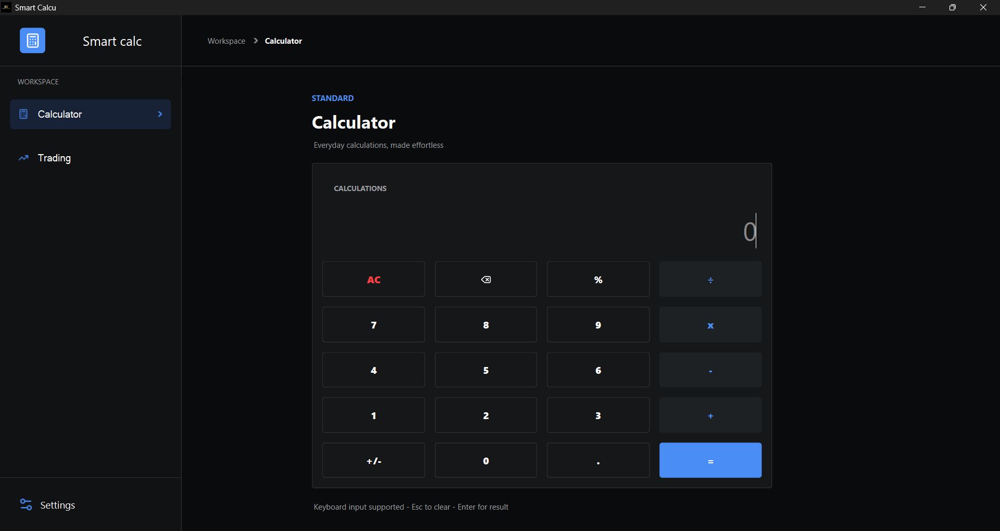
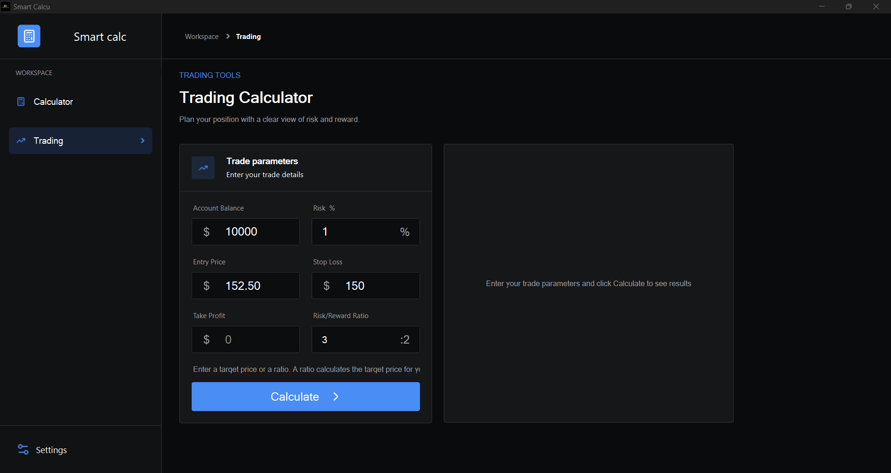
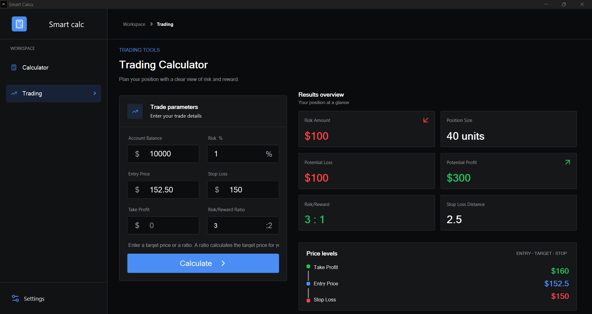
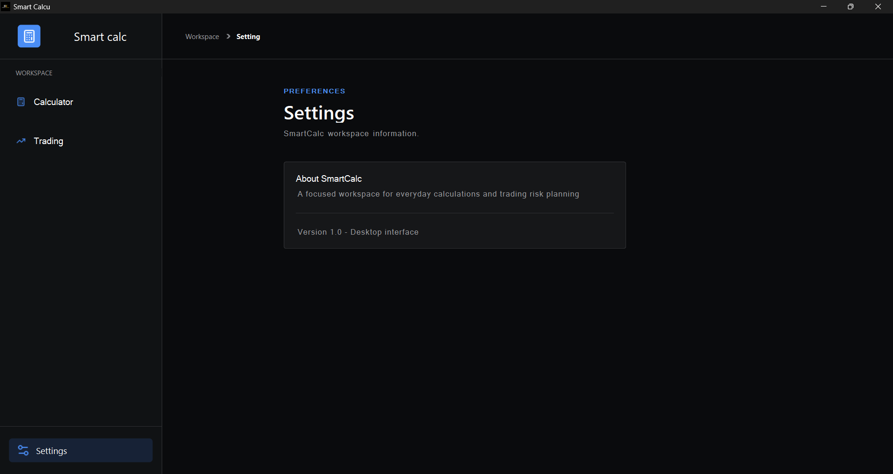

# 📱 SmartCalc – Modern Calculator & Trading Risk Manager

<div align="center">


**A modern, all-in-one desktop application for everyday calculations and trading risk management.**

</div>

---

## 📋 Table of Contents

- [About the Project](#-about-the-project)
- [Features](#-features)
- [Screenshots](#-screenshots)
- [Project Structure](#-project-structure)
- [Installation](#-installation)
- [Getting Started](#-getting-started)
- [How to Use](#-how-to-use)
- [Keyboard Shortcuts](#-keyboard-shortcuts)
- [Technical Architecture](#-technical-architecture)
- [Technologies Used](#-technologies-used)
- [Qt Features](#-qt-features)
- [Contributing](#-contributing)
- [License](#-license)
- [Contact](#-contact)
- [Resources](#-resources)

---

## 🎯 About the Project

**SmartCalc** is a modern desktop application developed using **Python** and **PySide6 (Qt6)**.

It combines two practical tools into one unified desktop workspace with a clean, modern interface and a professional dark theme.

The application includes:

1. **Standard Calculator** – Designed for everyday mathematical calculations.
2. **Trading Calculator** – Designed to help traders calculate position sizes, manage risk, and plan potential trade outcomes.

SmartCalc focuses on functionality, usability, and modern UI/UX design, providing an efficient experience for both everyday users and traders.

---

## ✨ Features

### 🧮 Standard Calculator

- ➕ Supports the four basic mathematical operations:
  - Addition (+)
  - Subtraction (−)
  - Multiplication (×)
  - Division (÷)
- 📊 Percentage calculations.
- 🔄 Positive/negative number conversion (+/−).
- ⌨️ Full keyboard input support.
- 🎨 Smooth hover effects for interactive buttons.
- 🛡️ Error handling for invalid input and division by zero.
- 🧹 Clear All (AC) functionality.
- ⌫ Backspace functionality for deleting the last character.

### 📈 Trading Calculator

A practical tool for calculating trading risk and position parameters.

**Features:**

- 💰 Calculates Risk Amount based on account balance and risk percentage.
- 📉 Calculates Potential Loss.
- 📈 Calculates Potential Profit.
- 📊 Calculates the Risk/Reward Ratio (R:R).
- 📏 Calculates Position Size.
- 📍 Calculates Stop Loss Distance.
- 🎯 Automatically identifies LONG and SHORT trade directions.
- 🔄 Automatically calculates Take Profit based on the specified Risk/Reward Ratio.
- ✅ Validates user inputs and checks trading price relationships.
- 📊 Displays important trading price levels, including Entry, Stop Loss, and Take Profit.

### 🎨 User Interface

- 🌙 Professional dark theme.
- 🧭 Sidebar navigation with custom SVG icons.
- 📑 Multi-page navigation using `QStackedWidget`.
- 🎯 Breadcrumb navigation in the top bar.
- 🖼️ Custom Lucide SVG icons.
- 🎨 Custom styling using Qt Style Sheets (QSS).
- 🖱️ Interactive buttons and hover effects.
- 📐 Organized layouts for a clean desktop experience.

---

## 📸 Screenshots

### 🧮 Standard Calculator

<p align="center">
  
</p>

### 📈 Trading Calculator – Input Section

<p align="center">
  
</p>

### 📊 Trading Calculator – Results Section

<p align="center">
  
</p>

### ⚙️ Settings Page

<p align="center">
  
</p>

### 🎬 Demo & Download


You can download the latest version of SmartCalc from the [Releases](../../releases/latest) section.

Download the installer, run it, and follow the installation instructions to get started.

---

## 📁 Project Structure

The project is organized into separate files to keep the user interface, application logic, and resources manageable.

```text
SmartCalc/
│
├── app.py                 # Standard calculator logic
│
├── calculator_ui.py       # Python UI module generated from Qt Designer
│
├── calculate_kh.ui        # Main calculator UI design file
│
├── resources_rc.py        # Compiled Qt resources (icons and assets)
│
├── resources.qrc          # Qt resource collection file
│
├── trade_section.py       # Trading calculator logic
│
└── window_ui.py           # Main window and application entry point
```

**File descriptions:**

| File | Description |
|---|---|
| `app.py` | Handles standard calculator operations and calculation logic. |
| `calculator_ui.py` | Contains the generated Python code for the calculator interface. |
| `calculate_kh.ui` | Contains the calculator interface designed in Qt Designer. |
| `resources_rc.py` | Contains compiled application resources, such as icons. |
| `resources.qrc` | Defines the Qt resources used by the application. |
| `trade_section.py` | Handles trading calculations and risk management logic. |
| `window_ui.py` | Manages the main application window and connects the different sections. |

---

## ⚙️ Installation

### Requirements

Make sure you have the following installed:

- Python 3.10 or newer.
- PySide6.
- Git (optional, for cloning the repository).

### 1. Clone the Repository

```bash
git clone https://github.com/your-username/SmartCalc.git
```

### 2. Navigate to the Project Directory

```bash
cd SmartCalc
```

### 3. Create a Virtual Environment (Recommended)

```bash
python -m venv .venv
```

Activate the environment:

**Windows:**

```bash
.venv\Scripts\activate
```

**Linux / macOS:**

```bash
source .venv/bin/activate
```

### 4. Install Dependencies

```bash
pip install PySide6
```

### 5. Run the Application

```bash
python window_ui.py
```

---

## 🚀 Getting Started

Once the application is running, you can switch between the Standard Calculator and Trading Calculator using the sidebar navigation.

Select the tool you need and enter the required values to perform your calculations.

---

## 🎮 How to Use

### 1. Standard Calculator

The Standard Calculator supports basic mathematical operations and keyboard interaction.

| Key / Button | Function |
|---|---|
| `0–9` | Enter numbers |
| `.` | Enter a decimal point |
| `+/-` | Change the number's sign |
| `%` | Calculate percentage |
| `+` | Addition |
| `-` | Subtraction |
| `×` or `*` | Multiplication |
| `÷` or `/` | Division |
| `=` | Calculate the result |
| `AC` | Clear all input |
| `⌫` | Delete the last character |

### 2. Trading Calculator

The Trading Calculator helps traders calculate potential risk and reward before entering a trade.

#### Required Inputs

The following fields are required:

| Input | Description |
|---|---|
| 💵 Account Balance | The total available account balance. |
| 💲 Entry Price | The planned trade entry price. |
| 📉 Stop Loss | The price level at which the trade should be closed to limit losses. |
| ⚠️ Risk % | The percentage of account balance you are willing to risk (0–100%). |

#### Optional Inputs

You must provide at least one of the following:

| Input | Description |
|---|---|
| 🎯 Take Profit | The target price for closing the trade in profit. |
| 📊 Risk/Reward Ratio | The desired ratio between potential risk and reward. |

If Take Profit is provided, the calculator can determine the Risk/Reward Ratio.

If the Risk/Reward Ratio is provided instead, the calculator can calculate the corresponding Take Profit level.

#### Calculation Results

| Output | Description |
|---|---|
| Risk Amount | The amount of money at risk, calculated from Balance × Risk %. |
| Potential Loss | The estimated loss if the Stop Loss is reached. |
| Potential Profit | The estimated profit if the Take Profit is reached. |
| Risk/Reward Ratio | The relationship between potential loss and potential profit. |
| Position Size | The calculated trading position size. |
| Stop Loss Distance | The price difference between Entry and Stop Loss. |
| Price Levels | Displays Take Profit, Entry Price, and Stop Loss levels. |
| Trade Direction | Identifies the trade as LONG or SHORT. |

**Important:** Trading calculations are estimates based on the entered values. Actual trading results may differ due to fees, slippage, leverage, and market conditions.

---

## ⌨️ Keyboard Shortcuts

The Standard Calculator supports the following keyboard shortcuts:

| Shortcut | Action |
|---|---|
| `Esc` | Clear the calculator |
| `Enter` | Calculate the result |
| `=` | Calculate the result |
| `Backspace` | Delete the last character |
| `0–9` | Enter numbers |
| `.` | Enter a decimal point |
| `+` | Addition |
| `-` | Subtraction |
| `*` | Multiplication |
| `/` | Division |

---

## 🏗️ Technical Architecture

SmartCalc uses a modular structure to separate interface design from application logic.

### Main Components

**1. Main Window (`window_ui.py`)**

- Initializes the main application window.
- Manages sidebar navigation.
- Controls page switching.
- Connects the calculator and trading sections.

**2. Standard Calculator (`app.py`)**

- Handles mathematical operations.
- Processes calculator input.
- Manages calculation results.
- Handles calculation errors.

**3. Calculator Interface (`calculator_ui.py`)**

- Provides the generated Python interface.
- Connects the designed UI elements to the application.

**4. Trading Calculator (`trade_section.py`)**

- Processes trading inputs.
- Validates price relationships.
- Calculates risk and reward.
- Determines position size and trade direction.

**5. Resources (`resources.qrc` and `resources_rc.py`)**

- Manages application icons and other embedded resources.
- Provides access to compiled SVG and other resource files.

---

## 🛠️ Technologies Used

| Technology | Version | Purpose |
|---|---|---|
| 🐍 Python | 3.10+ | Main programming language |
| 🎨 PySide6 (Qt6) | 6.12+ | Desktop GUI framework |
| 🖼️ Lucide Icons | 1.59* | SVG icon collection |
| 📐 Qt Designer | 6.x | Visual interface design |
| 🔧 pyside6-uic | - | Converts Qt Designer UI files into Python modules |
| 🎯 pyside6-rcc | - | Compiles Qt resource collection files |

*The Lucide Icons version should be verified against the actual icon assets used in the project.*

### Qt Features Used

| Qt Component | Purpose |
|---|---|
| `QMainWindow` | Main application window |
| `QStackedWidget` | Manages multiple application pages |
| `QRegularExpressionValidator` | Validates text input using regular expressions |
| `QObject.eventFilter()` | Filters keyboard and other application events |
| `QShortcut` | Creates keyboard shortcuts |
| `QKeySequence` | Defines keyboard shortcut sequences |
| `QSS (Qt Style Sheets)` | Styles the interface using CSS-like syntax |

---

## 🤝 Contributing

Contributions are welcome!

If you have ideas for improvements, bug fixes, or new features, feel free to contribute.

### How to Contribute

1. Fork this repository.
2. Create a new branch:

   ```bash
   git checkout -b feature/your-feature-name
   ```

3. Make your changes.
4. Commit your changes:

   ```bash
   git commit -m "Add: your feature description"
   ```

5. Push your branch:

   ```bash
   git push origin feature/your-feature-name
   ```

6. Open a Pull Request.

---

## 📄 License

This project is licensed under the **MIT License**.

Copyright (c) 2024 SmartCalc

Permission is hereby granted, free of charge, to any person obtaining a copy of this software and associated documentation files (the "Software"), to deal in the Software without restriction, including without limitation the rights to use, copy, modify, merge, publish, distribute, sublicense, and/or sell copies of the Software, and to permit persons to whom the Software is furnished to do so, subject to the following conditions:

The above copyright notice and this permission notice shall be included in all copies or substantial portions of the Software.

THE SOFTWARE IS PROVIDED "AS IS", WITHOUT WARRANTY OF ANY KIND, EXPRESS OR IMPLIED, INCLUDING BUT NOT LIMITED TO THE WARRANTIES OF MERCHANTABILITY, FITNESS FOR A PARTICULAR PURPOSE AND NONINFRINGEMENT. IN NO EVENT SHALL THE AUTHORS OR COPYRIGHT HOLDERS BE LIABLE FOR ANY CLAIM, DAMAGES OR OTHER LIABILITY, WHETHER IN AN ACTION OF CONTRACT, TORT OR OTHERWISE, ARISING FROM, OUT OF OR IN CONNECTION WITH THE SOFTWARE OR THE USE OR OTHER DEALINGS IN THE SOFTWARE.

For more information, see the [LICENSE](LICENSE) file.

---

## 📞 Contact

**Developer:** Your Name

- 📧 Email: esmatmorady2025@gmail.com
- 🐙 GitHub: [@Esmat-khaliqi](https://github.com/Esmat-khaliqi)


---

## 📚 Resources

- [PySide6 Official Documentation](https://doc.qt.io/qtforpython-6/)
- [Qt6 Official Documentation](https://doc.qt.io/qt-6/)
- [Lucide Icons](https://lucide.dev/)
- [Qt Style Sheets Reference](https://doc.qt.io/qt-6/stylesheet-reference.html)
- [Python Official Documentation](https://docs.python.org/3/)

---

<div align="center">

**⭐ If you find SmartCalc useful, please consider giving this project a star! ⭐**

Made with ❤️ and ☕ by the SmartCalc developer.

</div>
